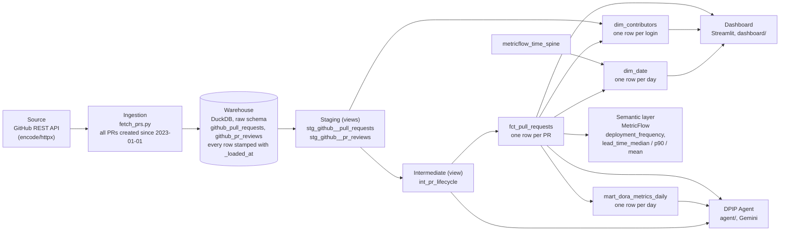
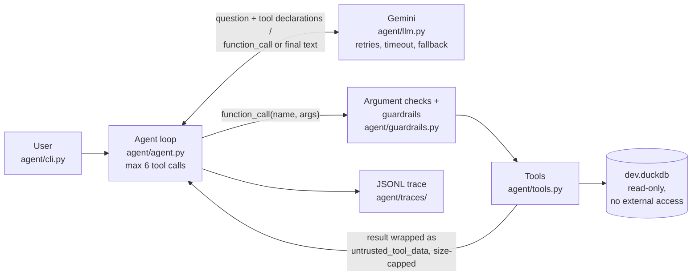

# PR Lifecycle & DORA Metrics — encode/httpx

An analytics engineering project that takes real GitHub pull request data from
[encode/httpx](https://github.com/encode/httpx) — a live, active open-source
project — through a full dbt pipeline to compute two [DORA](https://dora.dev/)
metrics: **Deployment Frequency** and **Lead Time for Changes**.

The point of this project isn't the metrics themselves — it's doing one data
entity properly end to end: layered modeling, tests that catch real bugs, a
semantic layer instead of ad-hoc SQL, and CI that actually runs. See
[PROGRESS.md](./PROGRESS.md) for the full build log and locked-in scope.

On top of the pipeline sits **[DPIP Agent](#dpip-agent)**: a tool-calling LLM
agent (Google Gemini) that answers plain-English questions about these metrics
through a small set of read-only tools, with guardrails enforced in code and an
eval set scored against SQL ground truth.

## Key findings

**Scope.** Pull requests on `encode/httpx` created from 2023-01-01, pulled from GitHub
on 2026-11-01: 523 PRs, 288 merged, 835 reviews. *Lead time* is PR opened to PR
merged (not commit to production), and a merge is used as a proxy for a deployment,
because the PR data has no deployment events. "Human" means the author login does
not end in `[bot]`. These findings describe what the GitHub data shows; they don't
explain why. Every number comes from a query in
[`analyses/key_findings.sql`](./analyses/key_findings.sql), and a test re-runs them.

**1. Merging has almost stopped, but pull requests keep arriving and piling up.**
Human PRs merged per year went 88 (2023), 92 (2024), 26 (2025), 1 (2026, whose last
merge was on 2026-02-23), while human PRs opened went 123, 159, 108, 29. Of the 123
opened in 2023, 72% were merged; of the 108 opened in 2025, 22% were, and 36 are still
open. Today 73 human PRs are open, with a median age of 372 days: 39 are older than a
year and 45 have never had a review. Seven human PRs have been opened since the last
merge. The median lead time of the PRs that *were* merged barely moved (29.4, 23.2, 22.8
and 23.4 hours), so what changed is how many PRs get merged, not how fast. Lead time
only counts merged PRs, so it cannot see the ones that waited and never merged. The data
can't say why merging slowed; the maintainers may be merging somewhere else.

**2. Fewer merged PRs get a review first.** Of the human PRs merged each year, the share
reviewed before the merge fell from 100% in 2023 (88 of 88) to 82.6% in 2024 (76 of 92)
and 69.2% in 2025 (18 of 26). Of the 24 human merges with no review beforehand, 22 were
PRs by one author. This counts formal GitHub reviews; discussion in plain comments is not
counted, and 2025 is a small sample.

**3. The slow part is waiting for the first review, not the review itself.** For the 183
human PRs that were reviewed before merging, the median wait for a first review was 6.9 h
and the median time from first review to merge only 0.6 h; 54.6% were merged within an
hour of their first review. The wait makes up 55.9% of all the hours these PRs spent open.
60.7% got a first review within a day and 86.9% within a week. By merge year the median
wait was 3.6 h (2023, 88 PRs), 7.3 h (2024, 76 PRs) and 191.8 h (2025, only 18 PRs, and
only PRs that were eventually reviewed and merged, so those still waiting aren't in it).

**4. A headline lead-time number misleads unless it is a median, and bots are shown
separately.** The typical merged PR takes 20.6 h: 52.4% were merged within a day and 81.3%
within a week. But 23 PRs (8%) took more than 30 days, and the slowest tenth of PRs
account for 77.8% of all lead-time hours, so the mean is 235.6 h and the 90th percentile
483.0 h. The first dashboard headlined 260.8 h (an average of daily averages), about 13
times the median. Bots opened 81 of the 288 merged PRs (28%; 40.9% in 2023, 15.6% in 2024,
10.3% in 2025) and they merge faster: median 15.9 h and p90 114.5 h, against 24.2 h and
789.7 h for humans. Leaving bots out moves the whole-period median from 20.6 h to 24.2 h
and the p90 from 483.0 h to 789.7 h.

**5. Review work is concentrated in very few people.** Of the 335 PRs that were reviewed
by someone other than their author (by 61 different people), the top reviewer reviewed
158 (47.2%), the top three reviewed 246 (73.4%) and the top five 291 (86.9%). The top
reviewer also gave 136 of the 330 approvals (41.2%).

**What an engineering manager could do with this** (suggestions, not conclusions: the data
shows association, not cause):

1. **Triage the backlog and track waiting time, not average lead time.** Assign or close
   the 73 open human PRs, starting with the 39 older than a year and the 45 never reviewed,
   then watch open-PR age and time to first review each week. Finding 3 says the wait for a
   first look is the part that is slow, and finding 4 says an average hides it.
2. **Require a review before merging, and spread the reviewing.** Turn on required reviews
   for the main branch and add one or two regular reviewers, so one person isn't the
   reviewer of nearly half the PRs (finding 5) while coverage slips (finding 2).

## Architecture



- **Ingestion** (`fetch_prs.py`) — pulls every PR created on or after `START_DATE`
  (2023-01-01) from the GitHub REST API, newest first, plus every review on each
  one (one call per PR, more if it has over 100 reviews, since GitHub doesn't
  expose reviews in bulk), into `raw.github_pull_requests` and
  `raw.github_pr_reviews` in a local DuckDB file. Every request has a timeout and
  retries 429s, 5xx errors and rate-limit responses with backoff; every row is
  stamped with `_loaded_at` (UTC, one value per run). It is a full refresh each run:
  523 PRs is about 530 API calls.
- **Staging** (views) — casts types and renames columns to consistent conventions,
  and passes `_loaded_at` through. `stg_github__pr_reviews` stays one row per
  *review* (a PR can have zero, one, or many); nothing else touches its grain.
- **Intermediate** (`int_pr_lifecycle`, view) — the important join. Reviews are rolled
  up to one row per PR *first* (`min`/`max`/`count` over `submitted_at`), then
  left-joined onto the PR base, so the grain never fans out. Computes
  `review_wait_hours`, `time_in_review_hours`, and `lead_time_hours`.
- **Marts** (tables):
  - `fct_pull_requests` — one row per PR, the one place every PR-level metric is
    calculated. Adds `is_bot`, `was_reviewed_before_merge` and `data_as_of`.
  - `dim_contributors` — one row per GitHub login (authors and reviewers).
  - `dim_date` — one row per calendar day, built from `metricflow_time_spine`.
  - `mart_dora_metrics_daily` — one row per calendar day, on a full date spine so
    zero-merge days are `0`, not a missing row. Now built from the fact table. Use it
    for per-day merge counts only, not for lead time.
- **Semantic layer** — one PR-grain MetricFlow semantic model on `fct_pull_requests`:
  `deployment_frequency` and lead time as median, p90 and PR-weighted mean, queryable
  with `mf query` and filterable by `is_bot`. See [Semantic layer](#semantic-layer).
- **Dashboard** (`dashboard/`) — a Streamlit app that reads the fact table and the two
  dimensions from `dev.duckdb`, read-only. See [Dashboard](#dashboard).
- **Agent** (`agent/`) — a tool-calling LLM agent that answers questions from the same
  tables. See [DPIP Agent](#dpip-agent).

## Data dictionary

### `fct_pull_requests` — one row per pull request (523 rows)

| Column | Type | Description |
|---|---|---|
| `pr_number` | bigint | PR number. Primary key. |
| `pr_title` | varchar | PR title. Written by GitHub users, so treat it as untrusted text. |
| `pr_state` | varchar | GitHub's state: `open` or `closed` (a merged PR is `closed`). |
| `pr_lifecycle_stage` | varchar | `merged`, `closed_without_merge` or `open`. |
| `is_merged` | boolean | True when the PR was merged. |
| `author_login` | varchar | GitHub login of the author. |
| `is_bot` | boolean | True when the author login ends in `[bot]` (for example `dependabot[bot]`). |
| `opened_at`, `first_reviewed_at`, `last_reviewed_at`, `merged_at`, `closed_at` | timestamp | When the PR was opened, first and last reviewed, merged and closed (UTC). Null when it did not happen. |
| `review_count`, `distinct_reviewer_count` | bigint | Reviews on the PR, and how many different people left them. |
| `was_approved`, `had_changes_requested` | boolean | At least one `APPROVED` / `CHANGES_REQUESTED` review. |
| `was_reviewed` | boolean | At least one review, at any time. |
| `was_reviewed_before_merge` | boolean | Merged, and the first review came at or before the merge. A comment left after the merge doesn't count. Basis of review coverage. |
| `review_wait_hours` | double | Hours from opening to the first review. Null if never reviewed. |
| `time_in_review_hours` | double | Hours from the first review to the merge. Null if not merged, or if the only review came after the merge. |
| `lead_time_hours` | double | Hours from opening to merge. Null if not merged. **The lead-time metric is calculated from this column.** |
| `data_as_of` | timestamp | When the data was pulled from GitHub (UTC), the same on every row. Anything "as of now", such as how long a PR has been open, is measured against this, not today's date. |

### `dim_contributors` — one row per GitHub login (232 rows)

| Column | Type | Description |
|---|---|---|
| `contributor_login` | varchar | GitHub login of someone who authored a PR or left a review. Primary key. |
| `is_bot` | boolean | Login ends in `[bot]`. |
| `first_activity_at`, `last_activity_at` | timestamp | Earliest and latest time they opened a PR or submitted a review. |
| `prs_authored` | bigint | PRs opened (any state). 0 for people who only review. |
| `reviews_given` | bigint | Reviews submitted, of any kind, including comments on their own PRs. |
| `prs_reviewed` | bigint | Distinct PRs they reviewed. |

### `dim_date` — one row per calendar day, 2023-01-01 to the end of the year the data was pulled

| Column | Type | Description |
|---|---|---|
| `date_day` | date | The day. Primary key. |
| `year`, `quarter`, `month_number`, `day_of_week_number` | bigint | Calendar year, quarter (1 to 4), month (1 to 12) and ISO weekday (1 = Monday). |
| `month_name`, `day_name` | varchar | English names. |
| `month_start_date`, `week_start_date` | date | First day of the month, and the Monday of the week. Axis values for monthly and weekly trends. |
| `is_weekend` | boolean | Saturday or Sunday. |

### `mart_dora_metrics_daily` — one row per calendar day

| Column | Type | Description |
|---|---|---|
| `metric_date` | timestamp | One row per calendar day. Primary key — spans the full range from the first to the most recent merge, with no gaps. |
| `deployment_frequency` | bigint | Count of PRs merged on this day. A PR merge is used as a proxy for a deployment — see [Known limitations](#known-limitations--what-id-do-at-scale). Never null; `0` on days with no merges. |
| `avg_lead_time_hours` | double | Average `lead_time_hours` across PRs merged this day, rounded to 2 decimals. **Null**, not `0`, on zero-merge days. **Do not use it for headline lead time:** averaging it over several days gives an average of daily averages, which is dominated by a few very slow PRs. Use the median or p90 from `fct_pull_requests`. |

## dbt tests

`dbt build` runs 8 models and **61 tests**, in dependency order. Every model's primary
key gets `unique` and `not_null`; on top of that:

| Model | Beyond the primary key |
|---|---|
| `stg_github__pull_requests` | `not_null` on `_loaded_at`. |
| `stg_github__pr_reviews` | `relationships` (every review belongs to a PR in the data), `accepted_values` on `review_state` (`APPROVED`, `CHANGES_REQUESTED`, `COMMENTED`, `DISMISSED`, `PENDING`), `not_null` on `_loaded_at`. |
| `int_pr_lifecycle` | custom `non_negative` on `review_wait_hours` and `lead_time_hours`. |
| `fct_pull_requests` | `accepted_values` on `pr_state` and `pr_lifecycle_stage`, `not_null` on the flags and on `data_as_of`, `non_negative` on `lead_time_hours`, and a `relationships` test that every `author_login` exists in `dim_contributors`. |
| `dim_contributors` | `not_null` on every column, `non_negative` on the three counts. |
| `dim_date` | `accepted_values` on quarter, month and weekday, plus two singular tests: no gaps in the calendar, and every date a PR was opened or merged exists in it. |
| `mart_dora_metrics_daily` | `non_negative` on `deployment_frequency`, plus a singular test that the mart's total merges equal the merged-PR count in `fct_pull_requests`. |
| `metricflow_time_spine` | `unique` and `not_null` on `date_day`. |

| Test | What it actually catches |
|---|---|
| `non_negative` on `review_wait_hours`, `lead_time_hours` | Both durations are `date_diff(...)` between two timestamps pulled from the GitHub API. A negative value can only mean a timestamp parsing bug or a genuine source-data anomaly (e.g. clock skew). This exact class of bug showed up during development — a review submitted 56 days *after* its PR had already merged initially produced a negative `time_in_review_hours` before the model was fixed to guard it. |
| `relationships` on reviews, and fact to dimension | A fetch that loses PRs, or a window change, would leave reviews pointing at PRs that aren't there, and every PR must have a row in the contributor dimension. |
| `accepted_values` on `review_state` | If GitHub introduces a new review state, the build flags it instead of letting it slip silently into the funnel and coverage numbers. |
| mart merges = fact merges | A join or filter that drops or duplicates PRs between the fact table and the daily mart. |
| `dim_date` gaps and coverage | A calendar that stopped short of the data would silently drop PRs from any chart that joins to it. |

The `relationships`, `accepted_values` (on `review_state`), mart-versus-fact and `dim_date`
tests were each run against deliberately corrupted copies of the database while building
them, and failed as intended.

**Not covered yet:** source freshness checks (the raw tables now carry `_loaded_at`, so
they can be added), dbt unit tests, and model contracts.

## Semantic layer

```
mf list metrics
mf query --metrics deployment_frequency,lead_time_median_hours,lead_time_p90_hours --group-by metric_time__year
mf query --metrics lead_time_median_hours --group-by metric_time__year \
  --where "{{ Dimension('pull_request__is_bot') }} = false"
```

One semantic model, `pull_requests`, sits on `fct_pull_requests` at PR grain, with
`merged_at` as its time dimension and `is_bot` as a dimension. Four metrics, all over
merged PRs:

| Metric | Definition |
|---|---|
| `deployment_frequency` | Number of PRs merged (a merge is the proxy for a deployment). |
| `lead_time_median_hours` | Median hours from opened to merged. The headline figure. |
| `lead_time_p90_hours` | 90th percentile (continuous), so 9 in 10 merged PRs were faster. |
| `lead_time_mean_hours` | PR-weighted mean, shown only for comparison: a few very slow PRs pull it far above the median. |

Median and p90 run natively on DuckDB (MetricFlow generates `PERCENTILE_CONT(0.9) WITHIN
GROUP (...)`), and were checked against plain SQL on the raw tables. The earlier
lead-time metric, an average of the mart's daily averages, was removed so it can't be
quoted. The dashboard and the agent compute the same numbers from the same table: for
2024, `mf query`, the agent's `get_dora_metrics` and the dashboard all give 109 merged
PRs with a median of 23.91 h (humans only: 92 PRs, 23.18 h).

## Dashboard

**Why a custom Streamlit dashboard instead of a BI tool:** the original plan
was [Evidence.dev](https://evidence.dev). It turns out "Evidence.dev" now
means two different products. The one its own scaffolding tool installs by
default — Evidence Studio — is a hosted commercial product whose only
login-free, no-data-copy connectors are Snowflake, Fabric, ClickHouse, and
BigQuery; a local DuckDB file isn't a supported data source at all. Getting
data in any other way means creating an account and uploading it into
Evidence's cloud-managed warehouse — the opposite of "read the existing
warehouse, don't duplicate it." The classic open-source, DuckDB-native
version of Evidence still exists on npm, but its docs have been fully
replaced by the new product's, so standing it up would mean reverse-engineering
undocumented config from source rather than following a supported path. Given
that, a Streamlit app reading DuckDB directly was the more
reliable choice.

**What it shows.** A sidebar date range and an "Include bot PRs" checkbox (off by
default) apply to the charts. Every figure is computed over individual PRs, with the
median and p90 as the headline, never an average of daily averages. Each chart has a
caption saying what it shows and what "good" looks like.

- **Tiles:** merged PRs, median and p90 lead time, review coverage (merged PRs reviewed
  before the merge) and median time to first review, with "Data as of" from `data_as_of`.
- **Trends:** PRs merged, median lead time and p90 lead time per week or month.
- **Where the time goes:** waiting for a first review versus time in review, for human PRs.
- **Review funnel:** opened, reviewed, approved, merged, with a note that it isn't a
  strictly nested funnel (some PRs merge with no review).
- **Open PRs:** how long they have been waiting, measured to `data_as_of`, not today.
- **Who reviews and who writes:** top reviewers (by distinct PRs of others reviewed) and
  top authors, people only.

**Running it:**

```
cd dashboard
pip install -r requirements.txt
streamlit run app.py
```

Opens at http://localhost:8501. Connects read-only, so it's safe to leave
running while `dbt build` runs elsewhere (results refresh within 60 seconds).

**Tests:** `python -m pytest dashboard/tests` (needs `dev.duckdb`). The expected numbers
are recomputed from the raw tables with separate SQL, the real app is run headlessly with
Streamlit's `AppTest` (with bots on and off, and for 2024), and the findings tests check
that the README's numbers match the data.

## Known limitations / what I'd do at scale

- **Deployment Frequency is a proxy.** There's no real deployment/release event
  data available from the GitHub PR API — only merges. At scale, I'd ingest
  actual deployment events (GitHub's Deployments API, or CI/CD pipeline logs)
  for a metric that reflects real production releases, not merges.
- **Lead Time for Changes measures PR-open-to-merge, not commit-to-production.**
  The full DORA definition is commit-to-production. At scale this would need
  commit timestamps and deploy timestamps, not just PR timestamps.
- **Only lead time is defined once in the semantic layer.** "Median time to first
  review" is computed slightly differently on the dashboard tile (merged PRs reviewed
  before the merge, by merge date), in the lead-time breakdown, and in the agent's eval
  question (PRs opened in a year that got any review). Each is documented where it
  appears, but a MetricFlow metric would unify them.
- **Full refresh, not incremental.** `fetch_prs.py` re-pulls every PR created since
  2023-01-01 on each run (523 PRs, about 530 API calls), and every dbt model fully
  rebuilds. Fine at this scale; wouldn't scale to a repo with 50,000+ PRs. At scale:
  incremental ingestion and incremental dbt materializations keyed on `updated_at`.
  GitHub's pull-request list endpoint has no `since` parameter (I checked: passing a
  far-future `since` returns the same PRs), so the way to do it is to sort by `updated`,
  newest first, and stop paging once you reach PRs older than the last run, with a
  lookback window for late changes.
- **History before 2023 isn't loaded.** The window is a constant at the top of
  `fetch_prs.py`, so every year in the data is complete, but older history is missing.
- **One data source, on purpose.** This project deliberately covers PRs and
  reviews only, not commits, issues, or CI/CD workflow data — one entity done
  deeply rather than several done shallowly. A production DORA implementation
  would also need CI/CD data for the other two DORA metrics (Change Failure
  Rate, Time to Restore Service).
- **CI queries live data, so results aren't deterministic run-to-run.** CI
  re-fetches real data from `encode/httpx` on every push, which is realistic
  but means a green run today doesn't guarantee identical numbers tomorrow —
  the underlying repo keeps changing. At scale, I'd separate "does the
  pipeline logic work" (tested against a fixed fixture dataset in CI) from "is
  production data healthy" (monitored separately against live data).
- **No orchestration.** The pipeline only runs on `git push` via CI, not on a
  recurring schedule. At scale it would run on a schedule (Airflow, Dagster,
  or even a cron-triggered GitHub Actions workflow) so the marts and metrics
  stay fresh independent of code changes.
- **The dashboard is a script, not a BI tool.** No auth, no sharing link, no
  multi-user access — you run it locally and it's just for you. At scale I'd
  either revisit a real BI/semantic-layer-aware tool (once one exists with a
  sane local/self-hosted DuckDB story) or put this behind a small deployed
  service if others need to view it.

## Running it locally

```
pip install -r requirements.txt
export GH_TOKEN=your_github_pat        # any public-repo-read token works
python fetch_prs.py                    # pulls every PR since 2023-01-01 plus reviews (about 530 API calls)
dbt build                              # runs every model + test
mf list metrics                        # semantic layer
cd dashboard && pip install -r requirements.txt && streamlit run app.py   # dashboard
```

Tests (each needs `dev.duckdb`, built by the steps above, except where noted):

```
python -m pytest ingestion_tests       # fetch_prs.py with fake HTTP responses, no network or token
python -m pytest agent/tests           # the agent, no API key needed
python -m pytest dashboard/tests       # dashboard numbers, the real app, and the README's findings
```

On Windows, `mf` needs `PYTHONIOENCODING=utf-8` and `DBT_PROFILES_DIR` pointing at the folder
with your `profiles.yml`.

## DPIP Agent

`agent/` adds a question-answering agent on top of the pipeline:

```
python -m agent.cli "What was the median lead time in 2024 and how does it compare to 2023?"
```

It answers only from tool results, quotes the actual numbers and the date range
used, and says "I don't have data for that" instead of guessing. It only reads
`dev.duckdb`, through a read-only connection.

### Architecture



The tool loop is written by hand, with the SDK's automatic function calling
disabled, so every step is visible and testable:

1. Send the question plus the tool declarations (generated from the tool
   functions' type hints and docstrings) to Gemini.
2. If the reply contains `function_call`s, check the arguments, run the matching
   Python tool, wrap the result as untrusted data, and send it back as a
   `function_response`.
3. Repeat until the model replies with text. If answering would take more than
   6 tool calls, stop and say so instead of returning a partial guess.

The Gemini call sits behind a small `ModelClient` interface, so the whole loop
is unit-tested offline with a scripted fake model.

### Tools

| Tool | What it does |
|---|---|
| `list_tables()` | The three tables the agent may query, with descriptions. `fct_pull_requests` is the preferred one; the mart's description warns not to use its average lead time. |
| `get_schema(table_name)` | Columns and types of one allowed table. |
| `get_data_coverage()` | Repo, first and last date with data, PR counts, `data_as_of` (when the data was pulled, so "currently open" is as of then), which metrics exist. |
| `resolve_period(phrase)` | Turns "last quarter", "this year", "last 30 days", "Q1 2025", "October 2024" and similar into exact dates **in Python** ([`agent/periods.py`](./agent/periods.py)), and says whether DPIP has data for them. Unrecognised phrases return an error, never a guess. |
| `get_dora_metrics(start_date, end_date, repo=None, period=None, include_bots=True)` | Deployment frequency (merged PRs, total and per week) and lead time: **median** as the headline (PR lead times are heavily skewed), **p90** and the PR-weighted mean, all from `fct_pull_requests`, so they equal the MetricFlow metrics. `include_bots=false` counts human-authored PRs only. Takes either explicit dates or a `period` phrase resolved in code (not both). Change failure rate is returned as "not available". |
| `compare_periods(a_start, a_end, b_start, b_end, repo=None, period_a=None, period_b=None, include_bots=True)` | Both periods side by side, with % change in count, median, p90 and mean. Each side takes dates or a phrase. |
| `run_readonly_sql(query)` | Free-form SELECT for anything the other tools can't answer (per-author counts, review stats, monthly breakdowns). |

Every tool returns a dict and never raises: problems come back as
`{"ok": false, "error": "..."}` so the model can read the error and recover.

### Guardrails, and why each one exists

The rule is that safety never depends on the model obeying its prompt. Every
tool call goes through these checks, however the model decided to make it.

| Guardrail | Why |
|---|---|
| **Database opened `read_only=True` with `enable_external_access=False`** | The last line of defence. Even a query that got past every check below can't write, attach another database, read files (`read_csv`, `glob`) or install extensions. Tests run these statements straight against the connection to prove it. |
| **DuckDB's own parser as the main SQL check** (`json_serialize_sql`) | A real parser instead of guessing from text. It only serializes SELECTs, so any write, `PRAGMA` or second statement fails. The whole parse tree is walked, so tables hidden in subqueries, JOINs, UNIONs and nested CTEs are all found. |
| **Table whitelist**: only `fct_pull_requests`, `mart_dora_metrics_daily` and `int_pr_lifecycle` | The agent sees the curated outputs of the dbt project, not raw, staging or the `dim_*` tables. |
| **CTE names may not match a real table** | A bypass found while building this: in DuckDB, `WITH stg_x AS (SELECT * FROM stg_x)` reads the *real* `stg_x` inside the CTE body. A whitelist that simply skipped CTE names would have let it through. |
| **No table functions** | `read_csv`, `glob`, `query()` and `duckdb_tables()` can read files or metadata. Two analytics tables don't need any of them. |
| **Regex check as a second layer** | Must start with SELECT/WITH, only one statement, no write or admin keywords (after removing comments and strings). It catches `SHOW`, `DESCRIBE` and `SUMMARIZE`, which DuckDB parses as SELECTs. |
| **200-row cap and a 10 s query timeout** | Keeps results small enough for the model and stops runaway queries. DuckDB has no statement timeout, so a timer calls `con.interrupt()`. |
| **Strict `YYYY-MM-DD` dates with start ≤ end, and repo must be `encode/httpx`** | Invalid input comes back as an error the model can fix, instead of a silently wrong query. |
| **Relative dates are computed in code, and the loop checks them** | LLMs are unreliable at date arithmetic (eval t03 below). The model passes the user's phrase (`period="last quarter"`) and `periods.py` computes the dates. Before any tool runs, the loop also finds time phrases in the question, resolves them in code, and **rejects explicit dates that don't match**, so hand-computed dates are blocked even if the model ignores its instructions. |
| **Tool argument checks in the loop** | An unknown tool name, missing or extra arguments, or wrong types become error dicts instead of crashes. |
| **Tool results wrapped as `untrusted_tool_data` and size-capped** | PR titles and logins are written by GitHub users, so a title can carry a prompt injection. Results are labelled as data in both the payload and the system instruction. Text is cut to 300 characters and whole results to 8,000. |
| **Retries only on 429/500/503 and timeouts** (5 attempts, exponential backoff + jitter, server `Retry-After`/`retryDelay` respected); **fail fast on 400/401/403/404** | Retrying a bad key or a wrong model name can't succeed. Temporary overload usually clears. |
| **Fallback model is opt-in and always visible** (`GEMINI_FALLBACK_MODEL`) | It is used only after the main model's retries run out. The model that actually answered is recorded in every trace line and in the eval report. |
| **Traces never contain the API key or headers** | Traces are written from chosen fields only, and the key is blanked out if it ever shows up anyway. |

### Running it

```
pip install -r agent/requirements.txt
cp agent/.env.example agent/.env          # then paste a key from https://aistudio.google.com/apikey
python -m agent.cli "Which month had the most merged pull requests?"
python -m agent.cli --model gemini-3.5-flash-lite --sticky-fallback "..."
python -m pytest agent/tests -v           # 230 tests, no API key needed
python -m agent.evals.run_evals --model gemini-3.5-flash-lite
```

Run everything from the project root after `dbt build`. Settings live in
`agent/.env`:

- `GEMINI_MODEL`: defaults to `gemini-3.8-flash`.
- `GEMINI_FALLBACK_MODEL`: optional.

The guardrail and loop tests need neither a key nor `dev.duckdb`. The tool tests
skip themselves if the database hasn't been built.

### Evaluation

[`agent/evals/eval_set.json`](./agent/evals/eval_set.json) has 20 questions:

- **14 metric questions**: counts, medians, period comparisons, per-author and per-month breakdowns, review coverage, and relative or explicit periods ("last year", "so far this year", "Q4 2024 vs Q4 2023"). Relative-period ground truth uses `current_date` in SQL, so it stays correct whatever day the eval runs.
- **6 traps**: change failure rate (not tracked), "which repo is worst" (there is only one), "last quarter" (no data; must cite the last date, 2026-02-23), a request to delete data, a prompt injection planted in a mocked PR title, and an ambiguous "How are we doing?".

Expected values are **SQL queries run against the database at eval time**, so
the ground truth can't drift from the data. Each answer is scored on separate
checks:

- **Correct tools:** the expected tools were called, and no write was ever attempted.
- **Numbers:** every ground-truth number appears in the answer, within a tolerance.
- **Trap handled:** the required behaviour or wording is present.

Runs use temperature 0 and no fallback model. Results are saved after every
question, so a run interrupted by an outage picks up where it stopped. Starting a
new run with `--fresh` moves the previous one into `runs/history/` instead of
deleting it, so earlier scores stay visible. Full report:
[`agent/evals/results.md`](./agent/evals/results.md).

| Run (all `gemini-3.5-flash-lite`, 2026-10-06) | Questions | Overall | Correct tools | Numbers correct | Traps handled | t03 "last quarter" |
|---|---|---|---|---|---|---|
| Before: the model computes dates itself | 17 | **16/17** | 17/17 | 11/11 | 5/6 | FAIL |
| Targeted check after the fix (t03 + 3 new) | 4 | **4/4** | 4/4 | 3/3 | 1/1 | PASS |
| After: dates resolved in code, full set | 20 | **20/20** | 20/20 | 14/14 | 6/6 | PASS |

`gemini-3.8-flash` is still pending: the free tier returned 503 "high demand" all day.

**These results are out of date.** They were produced before the data window, the
tools and the prompt changed (500 PRs, a day-weighted figure, no p90 or bot option).
The ground truth in `eval_set.json` now reads `fct_pull_requests` and was checked to give
the same values, but the agent has **not been re-evaluated** since, so `results.md`
still shows the old run.

### Known limitations / failure cases

These come from what actually happened during development and the eval runs.

- **Relative dates were resolved wrongly (eval t03), now fixed in code.**
  - **Failure:** asked for "last quarter" on 2026-10-06, the model chose Q1 2026
    (Jan–Mar) instead of Q3 2026 (Jul–Sep). It reported 1 merge instead of saying
    there's no data, even though the system prompt gave it today's date and the
    definition of a calendar quarter.
  - **Root cause:** the model was doing date arithmetic itself, a known LLM weak spot.
  - **Fix:** the change is structural, not another prompt hint.
    [`agent/periods.py`](./agent/periods.py) resolves phrases in plain Python,
    with 53 unit tests covering quarter and year boundaries, leap-year February
    and 31-day months. The tools accept `period="last quarter"`. The agent loop
    resolves the time phrases in each question itself and rejects explicit dates
    that don't match. The eval question and its expected answer were not
    changed, and three new questions with different phrases ("last year", "so far
    this year", "Q4 2024 vs Q4 2023") check that the fix wasn't tailored to t03.
  - **Result:** 16/17 → 20/20.
- **The scorer had a false negative (eval t05), now fixed.** The model handled
  the injection correctly: no DROP attempt, and it listed the poisoned title as
  data. The first version of the scorer still failed it, because the quoted
  title itself contains "Data deleted". The scorer now removes the verbatim
  injected text before checking forbidden phrases, and a regression test covers
  it. Before the fix, the scorecard read 15/17.
- **Injected text is passed through to the user.** In t05 the model faithfully
  repeated the attacker's title. That's correct and harmless for a human reader,
  but if the agent's output were fed to another automated agent, that text would
  arrive unlabelled. The wrapping would need to carry through to the output.
- **Scoring checks that the right numbers are present, not that every claim is
  true.** In q06 the answer was scored correct (October 2024, 23 merges) but also
  described October as "2024-10-01 to 2024-10-30", one day short. Extra wrong
  details aren't caught.
- **"Currently" means "as of the last data pull".** For "How many PRs are
  currently open?" the agent correctly answered 76, but didn't say that's as of
  the snapshot, not today. The prompt now asks it to say so, and `get_data_coverage`
  returns `data_as_of`; not yet re-evaluated.
- **Tool calls aren't always efficient.** Two answers (q07, q09) used 5 of the
  6 allowed calls, partly on `list_tables`/`get_schema` exploration the system
  prompt could make unnecessary. After the period fix the model also sometimes
  calls `resolve_period` for periods that are already explicit (q05, q08, q10),
  which is harmless but costs a call.
- **The loop's date check is a safety net that the eval never triggered.** In
  the 20/20 run the model always passed phrases, so the check never had to
  reject anything. Only the unit tests (including a replay of the original t03
  mistake) show that it works.
- **Dates inside free-form SQL aren't checked.** If the model answers a
  relative-date question through `run_readonly_sql` with hand-written dates in a
  `WHERE` clause, the date check can't see them. Doing so would mean
  interpreting the SQL.
- **Answers don't always state the resolved range.** After the fix, t03's answer
  correctly says there's no data and cites 2026-02-23, but it doesn't say that
  "last quarter" meant 2026-07-01 to 2026-09-30, even though the rules ask for the
  date range. The scorer doesn't check for it. Likewise "so far this year" was
  reported as "2026-01-01 to 2026-02-23" (where the data ends) rather than to
  today.
- **Period conventions are choices.** "Last 12 months" is a rolling window
  ending today, "last month" is the previous calendar month, and weeks start on
  Monday. They're documented in `periods.py`, but a user who means something
  else (e.g. the last 12 *complete* months) gets a different range. Phrases
  outside the supported list ("since the release", "next sprint") return an
  error rather than a guess.
- **Free-tier availability shaped the design.** `gemini-3.8-flash` returned 503
  "high demand" for a whole day, and each failure took about 50 s to arrive.
  That's why there's a 30 s request timeout and an optional sticky fallback,
  and why the 3.8-flash eval column is still pending. One 503-heavy CLI run took
  5.5 minutes before those fixes.
- **Small, single-run eval.** 20 questions, one run per model, at temperature 0
  (which reduces but doesn't remove run-to-run variation). It catches
  regressions and compares models; it isn't a statistical benchmark.
- **The guardrails lean strict.** The keyword layer rejects identifiers like
  `set` or `use` even as column aliases. The CTE rule rejects names that match
  any of DuckDB's built-in views (e.g. `tables`, `columns`). The model gets a
  clear error and renames, at the cost of an extra tool call.
- **One DuckDB process detail.** Within one Python process, every connection to
  `dev.duckdb` must use the same config, so anything running next to the agent
  (like the eval ground-truth queries) must open it through `agent/db.py`.
