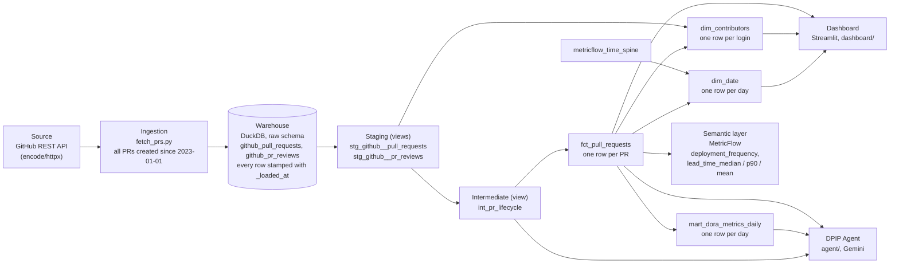
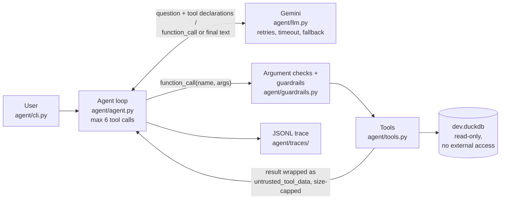

# PR Lifecycle & DORA Metrics — encode/httpx

An analytics engineering project that takes real GitHub pull request data from
[encode/httpx](https://github.com/encode/httpx) — a live, active open-source
project — through a full dbt pipeline to compute two [DORA](https://dora.dev/)
metrics: **Deployment Frequency** and **Lead Time for Changes**.

The point of this project isn't the metrics themselves — it's doing one data
entity properly end to end: layered modeling, tests that catch real bugs, a
semantic layer instead of ad-hoc SQL, and CI that actually runs. See
[PROGRESS.md](./PROGRESS.md) for the full build log and locked-in scope.

On top of the pipeline sits **[DPIP Agent](#dpip-agent)**: a tool-calling LLM
agent (Google Gemini) that answers plain-English questions about these metrics
through a small set of read-only tools, with guardrails enforced in code and an
eval set scored against SQL ground truth.

**Live demo:** _link coming soon (Streamlit Community Cloud)_. It shows the latest data published by the
[daily refresh](#daily-data-refresh-and-alerts); see [The public dashboard and the published snapshot](#the-public-dashboard-and-the-published-snapshot).

## Key findings

**Scope.** Pull requests on `encode/httpx` created from 2023-01-01, pulled from GitHub
on 2026-11-01: 523 PRs, 288 merged, 835 reviews. *Lead time* is PR opened to PR
merged (not commit to production), and a merge is used as a proxy for a deployment,
because the PR data has no deployment events. "Human" means the author login does
not end in `[bot]`. These findings describe what the GitHub data shows; they don't
explain why. Every number comes from a query in
[`analyses/key_findings.sql`](./analyses/key_findings.sql), and a test re-runs them.

**1. Merging has almost stopped, but pull requests keep arriving and piling up.**
Human PRs merged per year went 88 (2023), 92 (2024), 26 (2025), 1 (2026, whose last
merge was on 2026-02-23), while human PRs opened went 123, 159, 108, 29. Of the 123
opened in 2023, 72% were merged; of the 108 opened in 2025, 22% were, and 36 are still
open. Today 73 human PRs are open, with a median age of 372 days: 39 are older than a
year and 45 have never had a review. Seven human PRs have been opened since the last
merge. The median lead time of the PRs that *were* merged barely moved (29.4, 23.2, 22.8
and 23.4 hours), so what changed is how many PRs get merged, not how fast. Lead time
only counts merged PRs, so it cannot see the ones that waited and never merged. The data
can't say why merging slowed; the maintainers may be merging somewhere else.

**2. Fewer merged PRs get a review first.** Of the human PRs merged each year, the share
reviewed before the merge fell from 100% in 2023 (88 of 88) to 82.6% in 2024 (76 of 92)
and 69.2% in 2025 (18 of 26). Of the 24 human merges with no review beforehand, 22 were
PRs by one author. This counts formal GitHub reviews; discussion in plain comments is not
counted, and 2025 is a small sample.

**3. The slow part is waiting for the first review, not the review itself.** For the 183
human PRs that were reviewed before merging, the median wait for a first review was 6.9 h
and the median time from first review to merge only 0.6 h; 54.6% were merged within an
hour of their first review. The wait makes up 55.9% of all the hours these PRs spent open.
60.7% got a first review within a day and 86.9% within a week. By merge year the median
wait was 3.6 h (2023, 88 PRs), 7.3 h (2024, 76 PRs) and 191.8 h (2025, only 18 PRs, and
only PRs that were eventually reviewed and merged, so those still waiting aren't in it).

**4. A headline lead-time number misleads unless it is a median, and bots are shown
separately.** The typical merged PR takes 20.6 h: 52.4% were merged within a day and 81.3%
within a week. But 23 PRs (8%) took more than 30 days, and the slowest tenth of PRs
account for 77.8% of all lead-time hours, so the mean is 235.6 h and the 90th percentile
483.0 h. The first dashboard headlined 260.8 h (an average of daily averages), about 13
times the median. Bots opened 81 of the 288 merged PRs (28%; 40.9% in 2023, 15.6% in 2024,
10.3% in 2025) and they merge faster: median 15.9 h and p90 114.5 h, against 24.2 h and
789.7 h for humans. Leaving bots out moves the whole-period median from 20.6 h to 24.2 h
and the p90 from 483.0 h to 789.7 h.

**5. Review work is concentrated in very few people.** Of the 335 PRs that were reviewed
by someone other than their author (by 61 different people), the top reviewer reviewed
158 (47.2%), the top three reviewed 246 (73.4%) and the top five 291 (86.9%). The top
reviewer also gave 136 of the 330 approvals (41.2%).

**What an engineering manager could do with this** (suggestions, not conclusions: the data
shows association, not cause):

1. **Triage the backlog and track waiting time, not average lead time.** Assign or close
   the 73 open human PRs, starting with the 39 older than a year and the 45 never reviewed,
   then watch open-PR age and time to first review each week. Finding 3 says the wait for a
   first look is the part that is slow, and finding 4 says an average hides it.
2. **Require a review before merging, and spread the reviewing.** Turn on required reviews
   for the main branch and add one or two regular reviewers, so one person isn't the
   reviewer of nearly half the PRs (finding 5) while coverage slips (finding 2).

## Architecture



- **Ingestion** (`fetch_prs.py`) — pulls every PR created on or after `START_DATE`
  (2023-01-01) from the GitHub REST API, newest first, plus every review on each
  one (one call per PR, more if it has over 100 reviews, since GitHub doesn't
  expose reviews in bulk), into `raw.github_pull_requests` and
  `raw.github_pr_reviews` in a local DuckDB file. Every request has a timeout and
  retries 429s, 5xx errors and rate-limit responses with backoff; every row is
  stamped with `_loaded_at` (UTC, one value per run). It is a full refresh each run:
  523 PRs is about 530 API calls.
- **Staging** (views) — casts types and renames columns to consistent conventions,
  and passes `_loaded_at` through. `stg_github__pr_reviews` stays one row per
  *review* (a PR can have zero, one, or many); nothing else touches its grain.
- **Intermediate** (`int_pr_lifecycle`, view) — the important join. Reviews are rolled
  up to one row per PR *first* (`min`/`max`/`count` over `submitted_at`), then
  left-joined onto the PR base, so the grain never fans out. Computes
  `review_wait_hours`, `time_in_review_hours`, and `lead_time_hours`.
- **Marts** (tables):
  - `fct_pull_requests` — one row per PR, the one place every PR-level metric is
    calculated. Adds `is_bot`, `was_reviewed_before_merge` and `data_as_of`.
  - `dim_contributors` — one row per GitHub login (authors and reviewers).
  - `dim_date` — one row per calendar day, built from `metricflow_time_spine`.
  - `mart_dora_metrics_daily` — one row per calendar day, on a full date spine so
    zero-merge days are `0`, not a missing row. Now built from the fact table. Use it
    for per-day merge counts only, not for lead time.
- **Semantic layer** — one PR-grain MetricFlow semantic model on `fct_pull_requests`:
  `deployment_frequency` and lead time as median, p90 and PR-weighted mean, queryable
  with `mf query` and filterable by `is_bot`. See [Semantic layer](#semantic-layer).
- **Dashboard** (`dashboard/`) — a Streamlit app that reads the fact table and the two
  dimensions from `dev.duckdb`, read-only. See [Dashboard](#dashboard).
- **Agent** (`agent/`) — a tool-calling LLM agent that answers questions from the same
  tables. See [DPIP Agent](#dpip-agent).

## Data dictionary

### `fct_pull_requests` — one row per pull request (523 rows)

This table has an **enforced dbt contract**: every column, its type and whether it may be null is declared in
`models/marts/schema.yml`. If the model's SQL stops matching (a column added, dropped or retyped), or a row breaks
the declared rules, the build fails instead of quietly producing a different table. `pr_number` is a real primary
key in the database, and 15 columns are `NOT NULL`.

| Column | Type | Description |
|---|---|---|
| `pr_number` | bigint | PR number. Primary key. |
| `pr_title` | varchar | PR title. Written by GitHub users, so treat it as untrusted text. |
| `pr_state` | varchar | GitHub's state: `open` or `closed` (a merged PR is `closed`). |
| `pr_lifecycle_stage` | varchar | `merged`, `closed_without_merge` or `open`. |
| `is_merged` | boolean | True when the PR was merged. |
| `author_login` | varchar | GitHub login of the author. |
| `is_bot` | boolean | True when the author login ends in `[bot]` (for example `dependabot[bot]`). |
| `opened_at`, `first_reviewed_at`, `last_reviewed_at`, `merged_at`, `closed_at` | timestamp | When the PR was opened, first and last reviewed, merged and closed (UTC). Null when it did not happen. |
| `review_count`, `distinct_reviewer_count` | bigint | Reviews on the PR, and how many different people left them. |
| `was_approved`, `had_changes_requested` | boolean | At least one `APPROVED` / `CHANGES_REQUESTED` review, **at any time**. |
| `was_reviewed` | boolean | At least one review, at any time. |
| `was_reviewed_before_merge` | boolean | Merged, and the first review came at or before the merge. A comment left after the merge doesn't count. Basis of review coverage. |
| `was_approved_before_merge` | boolean | Merged, and the first `APPROVED` review came at or before the merge (the same rule). False for PRs that were never merged, never approved, or approved only after the merge. The dashboard's funnel uses this for merged PRs; `was_approved` is the any-time version. |
| `review_wait_hours` | double | Hours from opening to the first review. Null if never reviewed. |
| `time_in_review_hours` | double | Hours from the first review to the merge. Null if not merged, or if the only review came after the merge. |
| `lead_time_hours` | double | Hours from opening to merge. Null if not merged. **The lead-time metric is calculated from this column.** |
| `data_as_of` | timestamp | When the data was pulled from GitHub (UTC), the same on every row. Anything "as of now", such as how long a PR has been open, is measured against this, not today's date. |

### `dim_contributors` — one row per GitHub login (232 rows)

| Column | Type | Description |
|---|---|---|
| `contributor_login` | varchar | GitHub login of someone who authored a PR or left a review. Primary key. |
| `is_bot` | boolean | Login ends in `[bot]`. |
| `first_activity_at`, `last_activity_at` | timestamp | Earliest and latest time they opened a PR or submitted a review. |
| `prs_authored` | bigint | PRs opened (any state). 0 for people who only review. |
| `reviews_given` | bigint | Reviews submitted, of any kind, including comments on their own PRs. |
| `prs_reviewed` | bigint | Distinct PRs they reviewed. |

### `dim_date` — one row per calendar day, 2023-01-01 to the end of the year the data was pulled

| Column | Type | Description |
|---|---|---|
| `date_day` | date | The day. Primary key. |
| `year`, `quarter`, `month_number`, `day_of_week_number` | bigint | Calendar year, quarter (1 to 4), month (1 to 12) and ISO weekday (1 = Monday). |
| `month_name`, `day_name` | varchar | English names. |
| `month_start_date`, `week_start_date` | date | First day of the month, and the Monday of the week. Axis values for monthly and weekly trends. |
| `is_weekend` | boolean | Saturday or Sunday. |

### `mart_dora_metrics_daily` — one row per calendar day

| Column | Type | Description |
|---|---|---|
| `metric_date` | timestamp | One row per calendar day. Primary key — spans the full range from the first to the most recent merge, with no gaps. |
| `deployment_frequency` | bigint | Count of PRs merged on this day. A PR merge is used as a proxy for a deployment — see [Known limitations](#known-limitations--what-id-do-at-scale). Never null; `0` on days with no merges. |
| `avg_lead_time_hours` | double | Average `lead_time_hours` across PRs merged this day, rounded to 2 decimals. **Null**, not `0`, on zero-merge days. **Do not use it for headline lead time:** averaging it over several days gives an average of daily averages, which is dominated by a few very slow PRs. Use the median or p90 from `fct_pull_requests`. |

## dbt tests

`dbt build` runs 8 models, **63 data tests** and **6 unit tests** (77 in all), in dependency
order. Every model's primary key gets `unique` and `not_null`; on top of that:

| Model | Beyond the primary key |
|---|---|
| `stg_github__pull_requests` | `not_null` on `_loaded_at`. |
| `stg_github__pr_reviews` | `relationships` (every review belongs to a PR in the data), `accepted_values` on `review_state` (`APPROVED`, `CHANGES_REQUESTED`, `COMMENTED`, `DISMISSED`, `PENDING`), `not_null` on `_loaded_at`. |
| `int_pr_lifecycle` | custom `non_negative` on `review_wait_hours` and `lead_time_hours`. |
| `fct_pull_requests` | `accepted_values` on `pr_state` and `pr_lifecycle_stage`, `not_null` on the flags and on `data_as_of`, a singular test that `was_approved_before_merge` is a stricter version of `was_approved` and `was_reviewed_before_merge`, `non_negative` on `lead_time_hours`, and a `relationships` test that every `author_login` exists in `dim_contributors`. |
| `dim_contributors` | `not_null` on every column, `non_negative` on the three counts. |
| `dim_date` | `accepted_values` on quarter, month and weekday, plus two singular tests: no gaps in the calendar, and every date a PR was opened or merged exists in it. |
| `mart_dora_metrics_daily` | `non_negative` on `deployment_frequency`, plus a singular test that the mart's total merges equal the merged-PR count in `fct_pull_requests`. |
| `metricflow_time_spine` | `unique` and `not_null` on `date_day`. |

| Test | What it actually catches |
|---|---|
| `non_negative` on `review_wait_hours`, `lead_time_hours` | Both durations are `date_diff(...)` between two timestamps pulled from the GitHub API. A negative value can only mean a timestamp parsing bug or a genuine source-data anomaly (e.g. clock skew). This exact class of bug showed up during development — a review submitted 56 days *after* its PR had already merged initially produced a negative `time_in_review_hours` before the model was fixed to guard it. |
| `relationships` on reviews, and fact to dimension | A fetch that loses PRs, or a window change, would leave reviews pointing at PRs that aren't there, and every PR must have a row in the contributor dimension. |
| `accepted_values` on `review_state` | If GitHub introduces a new review state, the build flags it instead of letting it slip silently into the funnel and coverage numbers. |
| mart merges = fact merges | A join or filter that drops or duplicates PRs between the fact table and the daily mart. |
| `dim_date` gaps and coverage | A calendar that stopped short of the data would silently drop PRs from any chart that joins to it. |

The `relationships`, `accepted_values` (on `review_state`), mart-versus-fact and `dim_date`
tests were each run against deliberately corrupted copies of the database while building
them, and failed as intended.

**Unit tests.** Data tests check the real data; unit tests check the *logic*, by running a model's SQL on a few
made-up rows (`models/intermediate/unit_tests.yml`, `models/marts/unit_tests.yml`), so they give the same answer
whatever GitHub's data looks like:

| Unit test | What it pins down |
|---|---|
| `int_pr_lifecycle_review_after_merge_has_no_time_in_review` | A review that arrives after the PR was merged is not review time: `time_in_review_hours` is null, not negative. A control PR reviewed before merging does get a value. |
| `fct_pull_requests_review_after_merge_is_not_review_coverage` | The same PR is `was_reviewed` but not `was_reviewed_before_merge`, so it doesn't count toward review coverage. |
| `fct_pull_requests_review_coverage_boundary` | The "at or before the merge" rule: a review at the exact merge instant counts, one second later does not, and neither does a review on an unmerged PR or a merged PR with none. |
| `int_pr_lifecycle_rolls_many_reviews_up_to_one_row_per_pr` | Several out-of-order reviews collapse to one row with the earliest and latest times, reviewers counted once each and both flags set; a PR with no reviews still appears. |

Each unit test was shown to fail when the logic it covers is broken (the post-merge guard removed, distinct reviewers
replaced by a plain count, the first review taken from the latest one, `<=` changed to `<`, and coverage ignoring the
merge time), and to fail on a wrong expected value.

**Not covered yet:** source freshness checks (the raw tables now carry `_loaded_at`, so they can be added). Only
`fct_pull_requests` has a model contract so far.

## Semantic layer

```
mf list metrics
mf query --metrics deployment_frequency,lead_time_median_hours,lead_time_p90_hours --group-by metric_time__year
mf query --metrics lead_time_median_hours --group-by metric_time__year \
  --where "{{ Dimension('pull_request__is_bot') }} = false"
```

One semantic model, `pull_requests`, sits on `fct_pull_requests` at PR grain, with
`merged_at` as its time dimension and `is_bot` as a dimension. Four metrics, all over
merged PRs:

| Metric | Definition |
|---|---|
| `deployment_frequency` | Number of PRs merged (a merge is the proxy for a deployment). |
| `lead_time_median_hours` | Median hours from opened to merged. The headline figure. |
| `lead_time_p90_hours` | 90th percentile (continuous), so 9 in 10 merged PRs were faster. |
| `lead_time_mean_hours` | PR-weighted mean, shown only for comparison: a few very slow PRs pull it far above the median. |

Median and p90 run natively on DuckDB (MetricFlow generates `PERCENTILE_CONT(0.9) WITHIN
GROUP (...)`), and were checked against plain SQL on the raw tables. The earlier
lead-time metric, an average of the mart's daily averages, was removed so it can't be
quoted. The dashboard and the agent compute the same numbers from the same table: for
2024, `mf query`, the agent's `get_dora_metrics` and the dashboard all give 109 merged
PRs with a median of 23.91 h (humans only: 92 PRs, 23.18 h).

## Dashboard

**Why a custom Streamlit dashboard instead of a BI tool:** the original plan
was [Evidence.dev](https://evidence.dev). It turns out "Evidence.dev" now
means two different products. The one its own scaffolding tool installs by
default — Evidence Studio — is a hosted commercial product whose only
login-free, no-data-copy connectors are Snowflake, Fabric, ClickHouse, and
BigQuery; a local DuckDB file isn't a supported data source at all. Getting
data in any other way means creating an account and uploading it into
Evidence's cloud-managed warehouse — the opposite of "read the existing
warehouse, don't duplicate it." The classic open-source, DuckDB-native
version of Evidence still exists on npm, but its docs have been fully
replaced by the new product's, so standing it up would mean reverse-engineering
undocumented config from source rather than following a supported path. Given
that, a Streamlit app reading DuckDB directly was the more
reliable choice.

**What it shows.** A sidebar date range and an "Include bot PRs" checkbox (off by
default) apply to the charts. Every figure is computed over individual PRs, with the
median and p90 as the headline, never an average of daily averages. Each chart has a
caption saying what it shows and what "good" looks like.

**Date presets.** Under the date picker, one-click buttons choose a common range: *All
time*, *Last 12 months*, *2023*, *2024* and *2025*. The one that matches the current range
is highlighted. *Last 12 months* ends on the day the data was pulled, not today, so it
always selects the same window until the data is refreshed. The buttons are also the easy
way out of a half-finished pick: the picker only applies a range once both dates are chosen.

**Empty states.** If a date range and filter combination has no pull request or review
activity at all, the page shows a single message and nothing else (with a hint to tick
"Include bot PRs" when only bots were active). If there is activity but no merges, the
Trends section says so instead of drawing empty charts. A test checks that no chart is ever
drawn with nothing in it.

**Charts.** The PR-count charts have whole-number axes starting at zero, and their bars sit
on a band axis (one equal slot per bar), so the monthly chart shows wide bars labelled by
month. The weekly view has about 200 bars over the whole data range (201 weeks), so its bars
are necessarily thinner.

- **Tiles:** merged PRs, median and p90 lead time, review coverage (merged PRs reviewed
  before the merge) and median time to first review, with "Data as of" from `data_as_of`.
- **Trends:** PRs merged, median lead time and p90 lead time per week or month.
- **Where the time goes:** waiting for a first review versus time in review, for human PRs.
- **Review funnel:** opened, reviewed, approved, merged, with a note that it isn't a
  strictly nested funnel (some PRs merge with no review). "Reviewed" and "approved" both mean
  before the merge for a merged PR (`was_reviewed_before_merge`, `was_approved_before_merge`).
- **Open PRs:** how long they have been waiting, measured to `data_as_of`, not today.
- **Who reviews and who writes:** top reviewers (by distinct PRs of others reviewed) and
  top authors, people only.

**Running it:**

```
cd dashboard
pip install -r requirements.txt
streamlit run app.py
```

Opens at http://localhost:8501. Connects read-only, so it's safe to leave
running while `dbt build` runs elsewhere (results refresh within 60 seconds).

**Tests:** see [Testing](#testing). The dashboard's numbers are recomputed from the raw tables with
separate SQL, and pinned to the 50-PR test fixture whose answers were worked out by hand. The real app is
run headlessly with Streamlit's `AppTest` (with bots on and off, for 2024, for each date preset and for
empty ranges), the chart builder is tested on its specification (integer axes, band axis), and the
findings tests check that the README's numbers match a frozen copy of the data they describe.

## Known limitations / what I'd do at scale

- **Deployment Frequency is a proxy.** There's no real deployment/release event
  data available from the GitHub PR API — only merges. At scale, I'd ingest
  actual deployment events (GitHub's Deployments API, or CI/CD pipeline logs)
  for a metric that reflects real production releases, not merges.
- **Lead Time for Changes measures PR-open-to-merge, not commit-to-production.**
  The full DORA definition is commit-to-production. At scale this would need
  commit timestamps and deploy timestamps, not just PR timestamps.
- **Only lead time is defined once in the semantic layer.** "Median time to first
  review" is computed slightly differently on the dashboard tile (merged PRs reviewed
  before the merge, by merge date), in the lead-time breakdown, and in the agent's eval
  question (PRs opened in a year that got any review). Each is documented where it
  appears, but a MetricFlow metric would unify them.
- **Full refresh, not incremental.** `fetch_prs.py` re-pulls every PR created since
  2023-01-01 on each run (523 PRs, about 530 API calls), and every dbt model fully
  rebuilds. Fine at this scale; wouldn't scale to a repo with 50,000+ PRs. At scale:
  incremental ingestion and incremental dbt materializations keyed on `updated_at`.
  GitHub's pull-request list endpoint has no `since` parameter (I checked: passing a
  far-future `since` returns the same PRs), so the way to do it is to sort by `updated`,
  newest first, and stop paging once you reach PRs older than the last run, with a
  lookback window for late changes.
- **History before 2023 isn't loaded.** The window is a constant at the top of
  `fetch_prs.py`, so every year in the data is complete, but older history is missing.
- **One data source, on purpose.** This project deliberately covers PRs and
  reviews only, not commits, issues, or CI/CD workflow data — one entity done
  deeply rather than several done shallowly. A production DORA implementation
  would also need CI/CD data for the other two DORA metrics (Change Failure
  Rate, Time to Restore Service).
- **The live data is checked once a day, not continuously.** Every push builds the warehouse from files in the
  repository (a 50-PR fixture and a frozen copy of the 2026-11-01 pull), which makes a green run deterministic but
  blind to a change in GitHub's API or in the live data. The [daily refresh](#daily-data-refresh-and-alerts) covers
  that, so a problem can go unnoticed for up to a day. GitHub can also pause scheduled workflows in a repository with
  no activity for a while; the dashboard then shows a warning once its data is more than 48 hours old.
- **Orchestration is a cron-triggered GitHub Actions workflow.** It is enough for one repository and one daily
  pull. At scale I'd move to an orchestrator (Airflow, Dagster) for retries per step, backfills, dependencies
  between pipelines and a history of runs that is easier to query than workflow logs.
- **The dashboard is a script, not a BI tool.** The public copy is read-only, has no login and shows the whole
  dataset to anyone with the link, which is fine for public open-source data. It reads a Parquet snapshot published
  to a git branch, which suits a few files of a few hundred kilobytes once a day; at scale I'd publish to object
  storage (S3, GCS) and put the dashboard behind authentication, or use a BI tool that reads the semantic layer.

## Running it locally

```
pip install -r requirements.txt
export GH_TOKEN=your_github_pat        # any public-repo-read token works
python fetch_prs.py                    # pulls every PR since 2023-01-01 plus reviews (about 530 API calls)
dbt build                              # runs every model + test
mf list metrics                        # semantic layer
pip install -r dashboard/requirements.txt && streamlit run dashboard/app.py   # dashboard (reads dev.duckdb)
```

Tests: see [Testing](#testing) below. The short version: `python -m pytest ingestion_tests agent/tests dashboard/tests`
runs everything that needs no database; the rest needs a database file, and which one is explained there.

`mf` needs `DBT_PROFILES_DIR` pointing at the folder with your `profiles.yml`, on every system:
unlike `dbt`, it does not look in `~/.dbt` by itself and stops with "Could not find profile". On Windows
it also needs `PYTHONIOENCODING=utf-8`. CI sets the first one after writing its profile.

Run `dbt parse` (or `dbt build`) before `mf validate-configs`. If the project no longer parses, `mf` can
carry on and validate the *previous* manifest in `target/`, and report success for a config that is
actually broken. CI avoids this because it starts clean and runs `dbt build` first.

## Testing

The pipeline is tested on **three kinds of data**, because one kind cannot answer every question. A test says which kind
it needs with a marker, and a rule in `conftest.py` makes it fail loudly (never skip) if it is pointed at the wrong one.

| Kind of data | What it is | What it is for |
|---|---|---|
| **Fixture** (`fixtures/`) | 50 made-up pull requests, written by hand so that every awkward situation appears at least once (a review one second after the merge, a bot with "bot" in a person's name, an empty month, a leap day...). Never changes. | Checking the **code**. Every expected number is worked out from the case table in plain Python (`facts()`, `period_facts()`, `dashboard/tests/answer_key.py`), never copied from what the code prints. |
| **Frozen** (`fixtures/frozen/`) | A saved copy of the real pull of 2026-11-01 (523 PRs, 835 reviews), pinned by hash. | Checking that the **README's key findings** are still true of the data they describe. |
| **Live** (`dev.duckdb`, today's pull) | The real, changing data. | Checking things that must hold **whatever the data is**: counts add up, a number on the dashboard equals a fresh recount from the raw tables. |

Four markers (`pytest.ini`) put every test in exactly one group; a test checks that none is left out:

| Marker | Meaning | Tests |
|---|---|---|
| `no_db` | touches no database at all (a guard fails the test if it tries) | 461 |
| `any_data` | reads the database, asserts only what is true on any data | 123 |
| `fixture_numbers` | exact figures of the fixture | 67 |
| `frozen_data` | exact figures of the frozen real pull (the README findings) | 7 |

Which tests each automated run executes is written once, in `workflow_selections.py`: every push runs everything except
`frozen_data` on the fixture (651 tests) and then `frozen_data` on the frozen copy (7); the daily live run is limited to
`no_db or any_data` (584 tests), so a number that is only true of one day's data can never fail it. A test that belongs to
no run would never execute, so `ingestion_tests/test_marker_coverage.py` fails if any test is unclassified or unselected.

**Zero skips.** With `DPIP_FAIL_ON_SKIP=1` (set in CI) a skipped test is reported as a failure that names its reason.
Before this, CI said "260 passed, 230 skipped" and looked green while the 230 data-backed tests never ran; now a green run
means everything selected really ran.

Running it yourself (the same variable, `DPIP_DB_PATH`, points dbt, `mf`, the dashboard, the agent and the tests at one
database file; it defaults to `dev.duckdb`):

```
export DBT_PROFILES_DIR=profiles
python fixtures/load_fixture.py fixture.duckdb fixture        # or: frozen.duckdb frozen
DPIP_DB_PATH=fixture.duckdb dbt build
DPIP_DB_PATH=fixture.duckdb python -m pytest -m "not frozen_data"
DPIP_DB_PATH=frozen.duckdb  python -m pytest -m frozen_data   # after building frozen.duckdb the same way
python -m pytest -m "no_db or any_data"                       # on dev.duckdb: what the live run will check
```

`mf` reads the database's name from dbt's saved manifest, so after building a different file, run `dbt parse` (or
`dbt build`) against that same file before `mf validate-configs`; otherwise it looks for the previous file's name.

**What CI runs** (`.github/workflows/ci.yml`, on every push to `main` and every pull request, no secrets and no network):
load the fixture, `dbt build` (models, data tests and unit tests), `mf validate-configs` (catches semantic-layer mistakes
that parse fine but break against the tables), then the full test run with `DPIP_FAIL_ON_SKIP=1`; then load the frozen
copy, `dbt build` again, and run the README-findings tests. The live fetch from GitHub moved out of this workflow: it
needs a secret, and its result changes every day, so it does not belong in a gate that must be repeatable. It runs in
the daily refresh instead.

## Daily data refresh and alerts

`.github/workflows/refresh.yml` keeps the data fresh and checks it, every day at **02:47 UTC** (an off-peak minute,
since GitHub delays schedules that start on the hour), and whenever someone starts it by hand from the Actions tab.

**What a run does**, stopping at the first step that fails:

1. **Fetch** every PR and review from GitHub (`fetch_prs.py`, with the `GH_TOKEN` secret; only this step sees it).
2. **`dbt build`**: rebuild every model and run every data test and unit test on the new data.
3. **`dbt source freshness`**: how old is the newest fetch? Every raw row carries `_loaded_at`, the UTC time of the fetch
   that wrote it. Older than **36 hours** is a warning (one day was missed); older than **72 hours** fails the run (the
   data is three days stale). Right after a successful fetch this passes easily; it is there to catch a fetch that
   "succeeds" without writing new data. The dashboard has its own, stricter warning: it says so once its data is
   more than 48 hours old.
4. **`mf validate-configs`**: the metric definitions still work against the new tables.
5. **The tests that hold on any data** (`no_db or any_data`, 584 tests) with `DPIP_FAIL_ON_SKIP=1`. Tests that pin exact
   numbers are left out on purpose: today's numbers differ from yesterday's, and those tests already run on fixed data
   on every push.
6. **Export the snapshot** the public dashboard reads (`ops/export_snapshot.py`): reached only if every step above passed.
7. **Publish** it to the `data` branch, in a separate job (see [below](#the-public-dashboard-and-the-published-snapshot)).

**Nothing fails silently.** A last job, `alert`, runs after the refresh and the publish whether they passed or failed:

- the refresh or the publish **failed**: it opens a GitHub issue titled "Daily data refresh is failing", labelled
  `data-refresh-failure`, with a link to the run and the name of the step that failed. If that issue is already open,
  it adds a comment instead, so a week of failures is one issue with seven comments, not seven issues. GitHub notifies
  the repository's watchers of the new issue.
- both **succeeded**: if a failure issue is open, it comments with a link to the run that recovered and closes
  the issue.

The logic is in `ops/refresh_alert.py` and uses the `gh` command line with the workflow's own short-lived token.
Permissions are the minimum per job: the refresh can only read the repository; the publish job can push (and runs no project code,
only git, and never sees the GitHub API token); the alert job can write issues and read run details (to name the
failed step).

**Trying it out:** from the Actions tab, run "Daily data refresh" by hand with **simulate_failure** ticked. The run fails
on purpose before fetching anything and an issue opens (nothing is published); run it again normally and the issue
closes.

## The public dashboard and the published snapshot

The public dashboard has no database and no secrets. It reads a **snapshot**: the four tables it queries, exported to
Parquet by the daily refresh and published to the `data` branch of this repository.

**What is in the snapshot** (`ops/export_snapshot.py`): `fct_pull_requests`, `dim_contributors`, `dim_date` and
`pr_reviews` (the cleaned reviews, `stg_github__pr_reviews`) as Parquet files, plus `manifest.json`:

| Field | Meaning |
|---|---|
| `schema_version` | the snapshot format; a dashboard refuses a version it does not know |
| `generated_at` | when the export ran (UTC) |
| `data_as_of` | when the data was pulled from GitHub (UTC) |
| `source_commit` | the commit of `main` that built it |
| `tables` | for each file: the table it came from, row count, size and SHA-256 |

Before finishing, the export reads its own files back as the dashboard will and compares every table with the database,
row for row and column type for column type, so a bad snapshot fails the run instead of being published.

**How it is published.** Only when every check of the run has passed, a separate `publish` job force-pushes the folder to
the `data` branch as **one commit with no history**. The branch always holds exactly the newest snapshot and never grows,
and `main` is never touched. That job is the only one allowed to write to the repository, and it never sees the GitHub
API token.

**Where the dashboard gets its data** (`dashboard/data_source.py`), checked in this order:

1. `DPIP_DATA_SOURCE=local` or `=snapshot` forces one source (useful for testing).
2. The local database (`dev.duckdb`, or `DPIP_DB_PATH`) if the file exists: your machine, and CI.
3. Otherwise the published snapshot, downloaded from `raw.githubusercontent.com/<repo>/data/`.

The download is checked file by file against the SHA-256 in the manifest, and the verified copy is reused for up to an
hour. If a later download fails (no network, or a half-published branch whose files don't match the manifest), the page
keeps showing the last verified copy and says so in a banner, then tries again after five minutes. With no verified copy
at all, it shows an error page instead of numbers. The snapshot is opened as an in-memory DuckDB database with one view
per table, named exactly like the warehouse tables (`main.fct_pull_requests`, ...), so **every query in
`dashboard/queries.py` runs unchanged** on either source. A test runs every query function on both and requires
identical results.

The caption names the source ("Source: local database" or "Source: published snapshot"), and a banner warns when the
data was pulled more than **48 hours** ago, which means the daily refresh has missed at least one run.

**Why the deployment installs so little.** Streamlit Community Cloud looks for a dependency file next to the entrypoint
(`dashboard/app.py`) before the repository root, and uses the first one it finds. So it installs
`dashboard/requirements.txt` (Streamlit, DuckDB, Altair and pandas), not the root file with dbt, MetricFlow and the
Gemini SDK. Tests keep it that way (`dashboard/tests/test_deploy_footprint.py`): the dashboard never imports the agent,
its requirements contain no `google-genai` or dbt, they cover every package the dashboard imports, at the same pinned
versions as the rest of the project, and no other dependency file sits next to the entrypoint. No database file can be
committed (`*.duckdb` is ignored), so the deployment always reads the snapshot.

Trying the snapshot locally, without touching `dev.duckdb`:

```
python ops/export_snapshot.py dev.duckdb /tmp/snapshot
DPIP_DATA_SOURCE=snapshot DPIP_SNAPSHOT_URL=file:///tmp/snapshot streamlit run dashboard/app.py
```


## DPIP Agent

`agent/` adds a question-answering agent on top of the pipeline:

```
python -m agent.cli "What was the median lead time in 2024 and how does it compare to 2023?"
```

It answers only from tool results, quotes the actual numbers and the date range
used, and says "I don't have data for that" instead of guessing. It only reads
`dev.duckdb`, through a read-only connection.

### Architecture



The tool loop is written by hand, with the SDK's automatic function calling
disabled, so every step is visible and testable:

1. Send the question plus the tool declarations (generated from the tool
   functions' type hints and docstrings) to Gemini.
2. If the reply contains `function_call`s, check the arguments, run the matching
   Python tool, wrap the result as untrusted data, and send it back as a
   `function_response`.
3. Repeat until the model replies with text. If answering would take more than
   6 tool calls, stop and say so instead of returning a partial guess.

The Gemini call sits behind a small `ModelClient` interface, so the whole loop
is unit-tested offline with a scripted fake model.

### Tools

| Tool | What it does |
|---|---|
| `list_tables()` | The three tables the agent may query, with descriptions. `fct_pull_requests` is the preferred one; the mart's description warns not to use its average lead time. |
| `get_schema(table_name)` | Columns and types of one allowed table. |
| `get_data_coverage()` | Repo, first and last date with data, PR counts, `data_as_of` (when the data was pulled, so "currently open" is as of then), which metrics exist. |
| `resolve_period(phrase)` | Turns "last quarter", "this year", "last 30 days", "Q1 2025", "October 2024" and similar into exact dates **in Python** ([`agent/periods.py`](./agent/periods.py)), and says whether DPIP has data for them. Unrecognised phrases return an error, never a guess. |
| `get_dora_metrics(start_date, end_date, repo=None, period=None, include_bots=True)` | Deployment frequency (merged PRs, total and per week) and lead time: **median** as the headline (PR lead times are heavily skewed), **p90** and the PR-weighted mean, all from `fct_pull_requests`, so they equal the MetricFlow metrics. `include_bots=false` counts human-authored PRs only. Takes either explicit dates or a `period` phrase resolved in code (not both). Change failure rate is returned as "not available". |
| `compare_periods(a_start, a_end, b_start, b_end, repo=None, period_a=None, period_b=None, include_bots=True)` | Both periods side by side, with % change in count, median, p90 and mean. Each side takes dates or a phrase. |
| `run_readonly_sql(query)` | Free-form SELECT for anything the other tools can't answer (per-author counts, review stats, monthly breakdowns). |

Every tool returns a dict and never raises: problems come back as
`{"ok": false, "error": "..."}` so the model can read the error and recover.

### Guardrails, and why each one exists

The rule is that safety never depends on the model obeying its prompt. Every
tool call goes through these checks, however the model decided to make it.

| Guardrail | Why |
|---|---|
| **Database opened `read_only=True` with `enable_external_access=False`** | The last line of defence. Even a query that got past every check below can't write, attach another database, read files (`read_csv`, `glob`) or install extensions. Tests run these statements straight against the connection to prove it. |
| **DuckDB's own parser as the main SQL check** (`json_serialize_sql`) | A real parser instead of guessing from text. It only serializes SELECTs, so any write, `PRAGMA` or second statement fails. The whole parse tree is walked, so tables hidden in subqueries, JOINs, UNIONs and nested CTEs are all found. |
| **Table whitelist**: only `fct_pull_requests`, `mart_dora_metrics_daily` and `int_pr_lifecycle` | The agent sees the curated outputs of the dbt project, not raw, staging or the `dim_*` tables. |
| **CTE names may not match a real table** | A bypass found while building this: in DuckDB, `WITH stg_x AS (SELECT * FROM stg_x)` reads the *real* `stg_x` inside the CTE body. A whitelist that simply skipped CTE names would have let it through. |
| **No table functions** | `read_csv`, `glob`, `query()` and `duckdb_tables()` can read files or metadata. Two analytics tables don't need any of them. |
| **Regex check as a second layer** | Must start with SELECT/WITH, only one statement, no write or admin keywords (after removing comments and strings). It catches `SHOW`, `DESCRIBE` and `SUMMARIZE`, which DuckDB parses as SELECTs. |
| **200-row cap and a 10 s query timeout** | Keeps results small enough for the model and stops runaway queries. DuckDB has no statement timeout, so a timer calls `con.interrupt()`. |
| **Strict `YYYY-MM-DD` dates with start ≤ end, and repo must be `encode/httpx`** | Invalid input comes back as an error the model can fix, instead of a silently wrong query. |
| **Relative dates are computed in code, and the loop checks them** | LLMs are unreliable at date arithmetic (eval t03 below). The model passes the user's phrase (`period="last quarter"`) and `periods.py` computes the dates. Before any tool runs, the loop also finds time phrases in the question, resolves them in code, and **rejects explicit dates that don't match**, so hand-computed dates are blocked even if the model ignores its instructions. |
| **Tool argument checks in the loop** | An unknown tool name, missing or extra arguments, or wrong types become error dicts instead of crashes. |
| **Tool results wrapped as `untrusted_tool_data` and size-capped** | PR titles and logins are written by GitHub users, so a title can carry a prompt injection. Results are labelled as data in both the payload and the system instruction. Text is cut to 300 characters and whole results to 8,000. |
| **Retries only on 429/500/503/504 and timeouts** (5 attempts, exponential backoff + jitter, server `Retry-After`/`retryDelay` respected); **fail fast on 400/401/403/404** | Retrying a bad key or a wrong model name can't succeed. Temporary overload usually clears. |
| **Fallback model is opt-in and always visible** (`GEMINI_FALLBACK_MODEL`) | It is used only after the main model's retries run out. The model that actually answered is recorded in every trace line and in the eval report. |
| **Traces never contain the API key or headers** | Traces are written from chosen fields only, and the key is blanked out if it ever shows up anyway. |

### Running it

```
pip install -r agent/requirements.txt
cp agent/.env.example agent/.env          # then paste a key from https://aistudio.google.com/apikey
python -m agent.cli "Which month had the most merged pull requests?"
python -m agent.cli --model gemini-3.5-flash-lite --sticky-fallback "..."
python -m pytest agent/tests -v           # 255 tests, no API key needed
python -m agent.evals.run_evals --model gemini-3.5-flash-lite
```

Run everything from the project root after `dbt build`. Settings live in
`agent/.env`:

- `GEMINI_MODEL`: defaults to `gemini-3.5-flash-lite`, which answers reliably on the free
  tier. `gemini-3.8-flash` can be chosen with this setting, but it returned 503 and 504
  errors when tested on 2026-11-18, so it has not been evaluated.
- `GEMINI_FALLBACK_MODEL`: optional.

The guardrail and loop tests need neither a key nor `dev.duckdb`. The tool tests
skip themselves if the database hasn't been built.

### Evaluation

[`agent/evals/eval_set.json`](./agent/evals/eval_set.json) has 23 questions:

- **17 metric questions**: counts, medians, period comparisons, per-author and per-month breakdowns, review coverage, and relative or explicit periods ("last year", "so far this year", "Q4 2024 vs Q4 2023"). Relative-period ground truth uses `current_date` in SQL, so it stays correct whatever day the eval runs.
- **3 questions on the newer abilities** (q15 to q17): the median for human-written PRs only, the 90th percentile, and both together. A model that ignored the humans-only option would answer 23.91 h where the right answer is 23.18 h, and the scorer fails it (this is unit-tested).
- **6 traps**: change failure rate (not tracked), "which repo is worst" (there is only one), "last quarter" (no data; must cite the last date, 2026-02-23), a request to delete data, a prompt injection planted in a mocked PR title, and an ambiguous "How are we doing?".

Expected values are **SQL queries run against the database at eval time**, so
the ground truth can't drift from the data. Each answer is scored on separate
checks:

- **Correct tools:** the expected tools were called, and no write was ever attempted.
- **Numbers:** every ground-truth number appears in the answer, within a tolerance.
- **Trap handled:** the required behaviour or wording is present.

Runs use temperature 0 and no fallback model. Results are saved after every
question, so a run interrupted by an outage picks up where it stopped. Starting a
new run with `--fresh` moves the previous one into `runs/history/` instead of
deleting it, so earlier scores stay visible. Full report:
[`agent/evals/results.md`](./agent/evals/results.md).

| Run (all `gemini-3.5-flash-lite`) | Questions | Overall | Correct tools | Numbers correct | Traps handled | API errors | t03 "last quarter" |
|---|---|---|---|---|---|---|---|
| 2026-10-06, before: the model computes dates itself | 17 | **16/17** | 17/17 | 11/11 | 5/6 | 0 | FAIL |
| 2026-10-06, targeted check after the fix (t03 + 3 new) | 4 | **4/4** | 4/4 | 3/3 | 1/1 | 0 | PASS |
| 2026-10-06, after: dates resolved in code, full set | 20 | **20/20** | 20/20 | 14/14 | 6/6 | 0 | PASS |
| **2026-11-19, after Phase 1: one uninterrupted run of all 23 questions** (523 PRs, metrics from `fct_pull_requests`, p90 and bot option, new prompt) | 23 | **23/23** | 23/23 | 17/17 | 6/6 | 0 | PASS |

This is the current result: a single process, 8.5 minutes, no API errors (two 503 errors mid-run were retried
and recovered). It includes q15 to q17, which test the humans-only option and the p90 directly.
`gemini-3.8-flash` was **not evaluated**: the model was unavailable (503/504 errors on every question) on
2026-11-18, so the default is `gemini-3.5-flash-lite`.

For transparency, two earlier attempts are not the current result. A first run on 2026-11-18 also scored
23/23 but was put together in pieces (a dropped connection crashed it part-way, which led to retrying network
errors, and q15 to q17 were added and run afterwards); it is kept in `runs/history/`. A second run overnight
was discarded: the computer went offline for about four hours, so 9 questions failed with connection errors,
not wrong answers (the 14 that got an answer all passed).

Reading the answers, not just the scores: all 12 answers built on the metric tools say whether bot PRs are
included, all 7 lead-time answers quote the p90 next to the median, "how many PRs are currently open?" is dated
to the pull ("as of the data last pulled", 2026-11-01), and in `q15` and `q17` the model chose
`include_bots=false` on its own from the wording ("written by people", "human-written").

### Known limitations / failure cases

These come from what actually happened during development and the eval runs.

- **Relative dates were resolved wrongly (eval t03), now fixed in code.**
  - **Failure:** asked for "last quarter" on 2026-10-06, the model chose Q1 2026
    (Jan–Mar) instead of Q3 2026 (Jul–Sep). It reported 1 merge instead of saying
    there's no data, even though the system prompt gave it today's date and the
    definition of a calendar quarter.
  - **Root cause:** the model was doing date arithmetic itself, a known LLM weak spot.
  - **Fix:** the change is structural, not another prompt hint.
    [`agent/periods.py`](./agent/periods.py) resolves phrases in plain Python,
    with 53 unit tests covering quarter and year boundaries, leap-year February
    and 31-day months. The tools accept `period="last quarter"`. The agent loop
    resolves the time phrases in each question itself and rejects explicit dates
    that don't match. The eval question and its expected answer were not
    changed, and three new questions with different phrases ("last year", "so far
    this year", "Q4 2024 vs Q4 2023") check that the fix wasn't tailored to t03.
  - **Result:** 16/17 → 20/20.
- **The scorer had a false negative (eval t05), now fixed.** The model handled
  the injection correctly: no DROP attempt, and it listed the poisoned title as
  data. The first version of the scorer still failed it, because the quoted
  title itself contains "Data deleted". The scorer now removes the verbatim
  injected text before checking forbidden phrases, and a regression test covers
  it. Before the fix, the scorecard read 15/17.
- **Injected text is passed through to the user.** In t05 the model faithfully
  repeated the attacker's title. That's correct and harmless for a human reader,
  but if the agent's output were fed to another automated agent, that text would
  arrive unlabelled. The wrapping would need to carry through to the output.
- **Scoring checks that the right numbers are present, not that every claim is
  true.** In q06 the answer was scored correct (October 2024, 23 merges) but also
  described October as "2024-10-01 to 2024-10-30", one day short. Extra wrong
  details aren't caught.
- **"Currently" means "as of the last data pull".** In the October run the agent
  answered 76 open PRs without saying that's as of the snapshot, not today. The prompt
  now asks it to say so, and in the 2026-11-18 run it did ("as of the data last pulled
  ... 2026-11-01").
- **Tool calls aren't always efficient, and vary from run to run.** In the 2026-11-19 run
  q10 used all 6 allowed calls and q09 used 5, partly on `list_tables`/`get_schema`
  exploration the system prompt could make unnecessary, and q08 and q10 called
  `resolve_period` for periods that were already explicit. Both still passed, but q10 sits
  right at the limit. The earlier November run used 5 calls on q10, so even at temperature 0
  the number of calls is not stable. In October the same pattern showed up on q07 and q09.
- **The loop's date check is a safety net that the eval never triggered.** In
  every full run (October and November) the model always passed phrases, so the check
  never had to reject anything. Only the unit tests (including a replay of the original t03
  mistake) show that it works.
- **Dates inside free-form SQL aren't checked.** If the model answers a
  relative-date question through `run_readonly_sql` with hand-written dates in a
  `WHERE` clause, the date check can't see them. Doing so would mean
  interpreting the SQL.
- **Answers don't always state the resolved range.** After the fix, t03's answer
  correctly says there's no data and cites 2026-02-23, but it doesn't say that
  "last quarter" meant 2026-07-01 to 2026-09-30, even though the rules ask for the
  date range. The scorer doesn't check for it. Likewise "so far this year" was
  reported as "2026-01-01 to 2026-02-23" (where the data ends) rather than to
  today.
- **Period conventions are choices.** "Last 12 months" is a rolling window
  ending today, "last month" is the previous calendar month, and weeks start on
  Monday. They're documented in `periods.py`, but a user who means something
  else (e.g. the last 12 *complete* months) gets a different range. Phrases
  outside the supported list ("since the release", "next sprint") return an
  error rather than a guess.
- **Free-tier availability shaped the design.** `gemini-3.8-flash` returned 503
  "high demand" for a whole day in October, and each failure took about 50 s to arrive.
  That's why there's a 30 s request timeout and an optional sticky fallback. One
  503-heavy CLI run took 5.5 minutes before those fixes. When tested again on
  2026-11-18 it returned 503 and 504 errors on every question, which also showed that a
  504 had been wrongly treated as permanent (now retried). That is why the default
  model is `gemini-3.5-flash-lite`, and why the 3.8-flash eval column is not evaluated.
- **Small, single-run eval.** 23 questions, one run per model, at temperature 0
  (which reduces but doesn't remove run-to-run variation). It catches
  regressions and compares models; it isn't a statistical benchmark.
- **The guardrails lean strict.** The keyword layer rejects identifiers like
  `set` or `use` even as column aliases. The CTE rule rejects names that match
  any of DuckDB's built-in views (e.g. `tables`, `columns`). The model gets a
  clear error and renames, at the cost of an extra tool call.
- **One DuckDB process detail.** Within one Python process, every connection to
  `dev.duckdb` must use the same config, so anything running next to the agent
  (like the eval ground-truth queries) must open it through `agent/db.py`.
